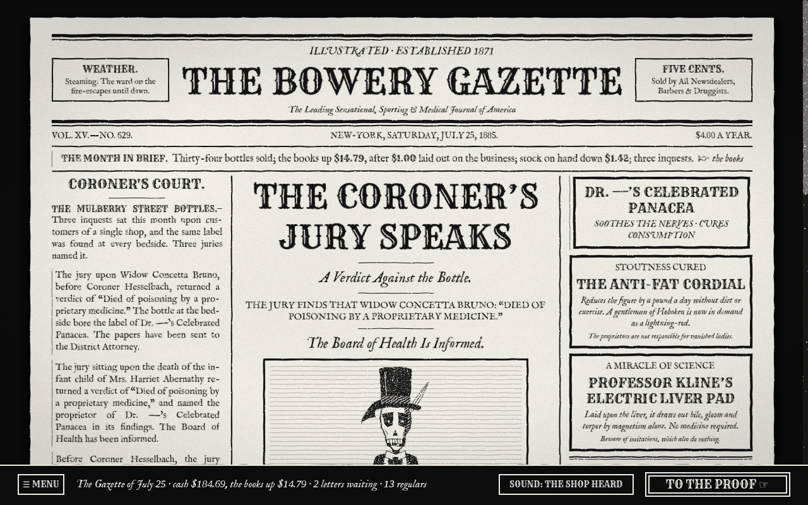
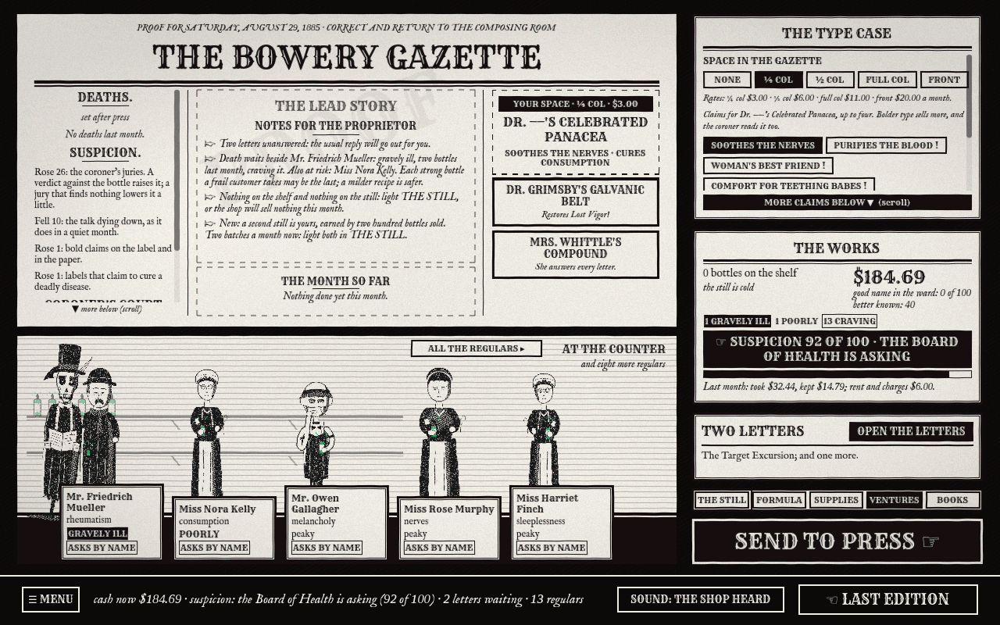
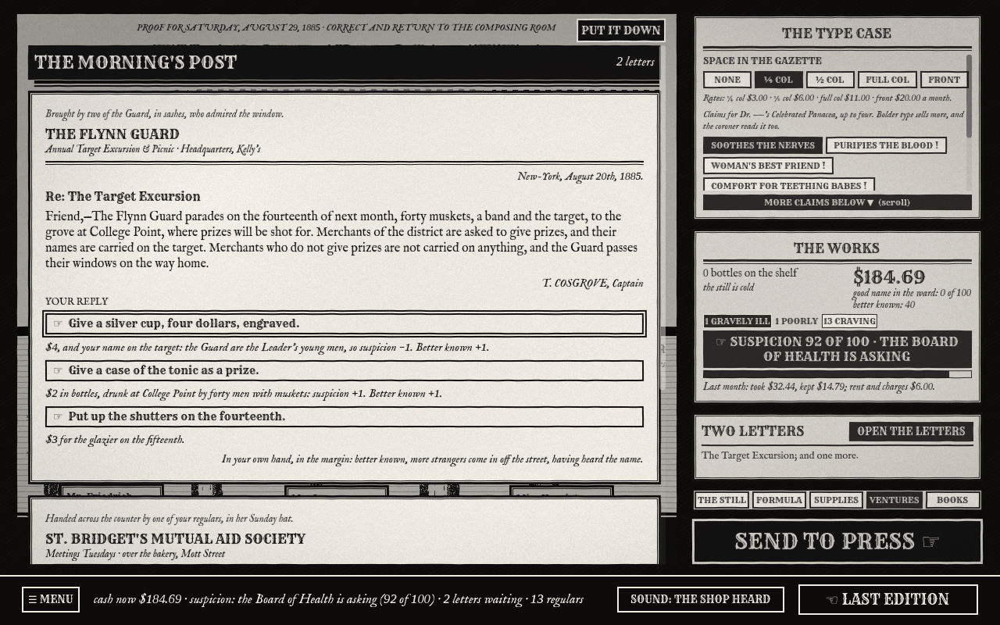
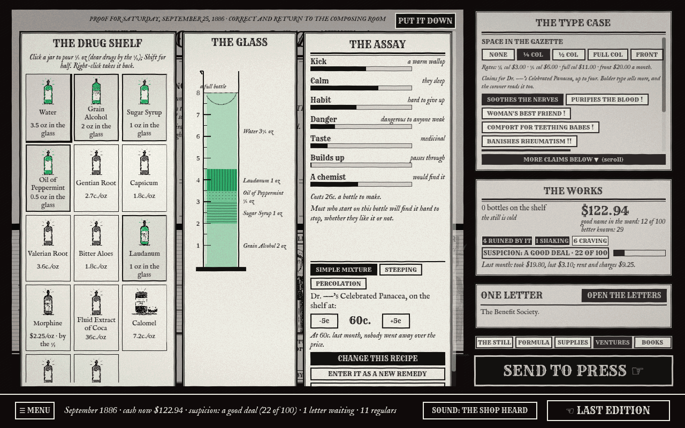
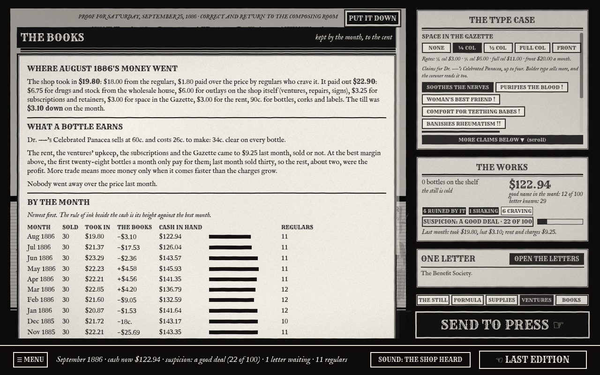
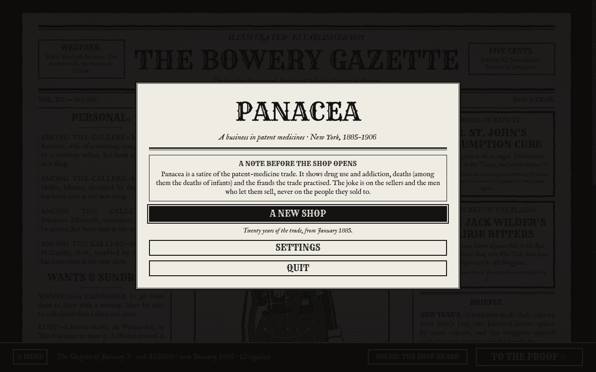

# Panacea

_A business in patent medicines. New York, 1885–1906._

No FDA, no labelling law, and no limit on what you may bottle and call a cure. You open a small apothecary on
Mulberry street with $150, a still and a column of advertising space, and you have until the Pure Food and Drug Act
of 1906 to make something of it. Whether that something is an honest tonic or a ward full of customers who can't stop
buying is up to you. The newspaper will print the result either way.



Panacea is a dark-satirical tycoon game told entirely in printed matter: a sensational weekly, a proof sheet, the
morning's post, a formula book and a ledger, in black ink on newsprint. Scheele's green is kept for the product.

> **A note before the shop opens.** Panacea is a satire of the patent-medicine trade. It shows drug use and
> addiction, deaths (among them the deaths of infants) and the frauds the trade practised. The joke is on the sellers
> and the men who let them sell, never on the people they sold to.

## How a month goes

1. **Read the paper.** Each month opens on a new edition of _The Bowery Gazette_. Its lead story, its deaths column,
   its coroner's court and its trade notes are what your last month did to the ward. Any item can be clipped for the
   details.
2. **Correct the proof.** The next edition's proof is your desk. From it you:
   - mix a remedy in the **formula book**, pouring from the drug shelf into a measuring glass while the assay tells
     you what the bottle will do to whoever takes it;
   - light **the still** and bottle a batch;
   - set the **claims** on your label, from "SOOTHES THE NERVES" to "CURES CONSUMPTION !!!", and buy space in the
     Gazette to print them;
   - answer **the morning's post**: the coroner, the Board of Health, a rival two doors down, the benefit society, a
     widow, a detective who keeps a book of who paid;
   - order drugs, take up **ventures** (a second shop, an almanac, a wholesale contract), and read **the books**.
3. **Send to press.** The month runs, and the consequences arrive in the next edition.

A full game runs from January 1885 to December 1906: 264 months. A shop can also be closed sooner, by its creditors or by the Board of Health.

## Screenshots

<table>
  <tr>
    <td width="50%"></td>
    <td width="50%"></td>
  </tr>
  <tr>
    <td><b>The proof.</b> Notes for the month, what moved suspicion, your regulars at the counter and the state of the works.</td>
    <td><b>The morning's post.</b> About 180 letters across two decades. Every reply prints what it will cost before you choose.</td>
  </tr>
  <tr>
    <td></td>
    <td></td>
  </tr>
  <tr>
    <td><b>The formula book.</b> Pour from the shelf into the glass. The assay reads kick, calm, habit and danger as you pour.</td>
    <td><b>The books.</b> Kept by the month, to the cent: where the money went, what a bottle clears, and the shop's whole history.</td>
  </tr>
  <tr>
    <td></td>
    <td><b>The title page.</b> One shop, saved as you go. CONTINUE puts you back on the page you left.</td>
  </tr>
</table>

## What's in it

- **A paper that keeps up with you.** Each edition is written from what happened in your shop and set among the news
  of its month: Grant's funeral, Jumbo, the Pedestal Fund, the Blizzard, Roosevelt's Police Board, the 1906 Act.
  Its written items are rationed to last the whole game: a city item is never printed twice within ten years.
- **A market with a conscience, of sorts.** Price, strength and claims all matter, and each has a cost. A habit
  sells bottles and fills the deaths column. Bold claims sell in the first year and disappoint after it. A quarter
  of the ward's households won't have a strong narcotic in the house at all.
- **Consequences you can read.** Suspicion, the health of every regular and the reasons for both are on the proof in
  words. An inquest letter prints the odds of each reply before you make it.
- **An honest shop is a real way to play.** So is the other kind. The paper has a headline for both.
- **Readable and reachable.** Three text sizes, strong contrast, nothing shown by colour alone, and every screen
  and drawer reachable from the keyboard.
- **Deterministic underneath.** A save is a seed and a list of what you did. Loading replays it, so the shop and the
  paper come back exactly.

## Play it

There is no hosted version: the game is a desktop program. Every change to the game is built for Linux, Windows and
macOS by a GitHub workflow, and the builds are attached to the run.

1. Open the [**Build the game** workflow](https://github.com/EnochZheng1/panacea/actions/workflows/build.yml) and
   choose the latest run with a green tick.
2. Under **Artifacts**, download the build for your system. You need to be signed in to GitHub to download.
   Builds are kept for 30 days; if the latest has expired, press **Run workflow** to make a new one.

| System  | Artifact          | To run it                                                                                                                                                                                                                          |
| ------- | ----------------- | ---------------------------------------------------------------------------------------------------------------------------------------------------------------------------------------------------------------------------------- |
| Windows | `Panacea-windows` | Unzip, keep the files together, and run `Panacea.exe`. The build is unsigned, so SmartScreen may ask: choose **More info**, then **Run anyway**.                                                                                   |
| macOS   | `Panacea-macos`   | Unzip twice to get `Panacea.app` (Intel and Apple silicon). It is ad-hoc signed and not notarized, so the first launch must be allowed under **System Settings → Privacy & Security → Open Anyway**. Not yet tested on a real Mac. |
| Linux   | `Panacea-linux`   | Unzip, then `tar -xzf Panacea-linux.tar.gz` and run `./Panacea.x86_64` (x86-64).                                                                                                                                                   |

The game needs a graphics card that supports Vulkan (Metal on macOS). It keeps one shop, saved as you go, in Godot's
user folder:

| System  | Save folder                                                 |
| ------- | ----------------------------------------------------------- |
| Windows | `%APPDATA%\Godot\app_userdata\Panacea\`                     |
| macOS   | `~/Library/Application Support/Godot/app_userdata/Panacea/` |
| Linux   | `~/.local/share/godot/app_userdata/Panacea/`                |

## Run it from source

You need [Godot 4.7.2, the .NET build](https://godotengine.org/download), and the .NET 8 SDK.

```bash
cd godot && dotnet build
```

```bash
godot --headless --path godot --import
```

```bash
godot --path godot
```

The import is needed once, and again after art changes. Or open `godot/project.godot` in the Godot editor and press
Play. To export a build yourself, install Godot's export
templates for 4.7.2 (.NET) and run, for example:

```bash
cd godot && godot --headless --export-release Linux ../build/linux/Panacea.x86_64
```

The presets are `Linux`, `Windows` and `macOS`. Builds go to `build/`, which git ignores.

Arguments after `--` are for development. They skip the title page and never touch the save:

| Argument                          | What it does                                                           |
| --------------------------------- | ---------------------------------------------------------------------- |
| `--seed NAME`                     | Start a shop from a named seed                                         |
| `--play N --dose D`               | Let a scripted proprietor play N months first, at D ounces of laudanum |
| `--screen proof --drawer letters` | Open on the proof, with a drawer open                                  |
| `--textsize larger`               | Start at a text size (`regular`, `large`, `larger`)                    |
| `--shot out.png --frames 40`      | Save a screenshot and quit                                             |
| `--driver PORT`                   | Take clicks and keys over a local socket (see `godot/tools/drive.py`)  |

## How it's built

The rules live in a pure, deterministic simulation with no rendering and no clock. It exists twice: the TypeScript
reference, which the bots and the balance tools play at speed, and a C# port, which the game runs. Recorded games
(`sim-cs/fixtures`) hold the two to the same result, action for action.

| Path                | What it is                                                                                  |
| ------------------- | ------------------------------------------------------------------------------------------- |
| `godot/`            | The game: Godot 4 (.NET), C# scripts, the woodcut art and its build tools, the paper's copy |
| `sim-cs/`           | The simulation in C#, its tests, and the parity fixtures                                    |
| `packages/sim`      | The simulation in TypeScript: state, the month's pipeline, actions, a machine API for bots  |
| `packages/content`  | Game data (ingredients, letters, ventures, the ward), schemas, strings and a content linter |
| `packages/playtest` | Strategy bots, a batch harness, an exploit-hunting optimizer and balance reports            |
| `packages/client`   | A debug client in the browser, for playing the simulation by hand                           |
| `packages/game`     | An earlier browser prototype of the shop in 3D, kept for reference                          |
| `playtests/`        | Eleven rounds of persona playtests, with the write-up of each fix pass between them         |
| `docs/`             | The design and technical documents                                                          |

### Checks

Requires Node 22.12+ and pnpm 10 for the TypeScript side, and the .NET 8 SDK for the C# side.

```bash
pnpm install
```

```bash
pnpm check
```

```bash
cd sim-cs && dotnet test
```

`pnpm check` runs formatting, lint, typecheck, the content linter and the TypeScript tests. Other commands:

| Command                                                      | What it does                                                         |
| ------------------------------------------------------------ | -------------------------------------------------------------------- |
| `pnpm content:lint`                                          | Validate the game data and its cross-references                      |
| `pnpm sim:batch --runs 100`                                  | Run every bot over many seeded games and print a balance report      |
| `pnpm sim:optimize --candidates 60 --seeds 4`                | Search for the most profitable strategy (the exploit hunter)         |
| `pnpm exec tsx packages/playtest/src/cli/parity-fixtures.ts` | Re-record the parity fixtures after a change to the rules or content |
| `python3 godot/tools/check_cuts.py`                          | Check the cropped art is up to date with its sources                 |
| `pnpm client:dev`                                            | The debug client                                                     |

Two workflows run on GitHub: `ci.yml` runs the checks on every push, and `build.yml` exports the game.

## Playtesting

The game is reviewed in rounds by panels of simulated first-time players, each with a persona (a historian, a
min-maxer, a low-vision player, a keyboard-only player, a commuter who plays in ten-minute bursts). They play a frozen
build by hand through the driver and write a report; a fix pass follows each round. The reports, summaries and
fix-pass write-ups are in [`playtests/`](playtests/), most recently
[round 11](playtests/round11/SUMMARY.md).

## Documents

- [Game design](docs/GAME_DESIGN.md): premise, systems, progression, and the rules the satire keeps
- [Technical plan](docs/TECHNICAL_PLAN.md): architecture and milestones (written for the first, TypeScript client;
  the engine note at its top describes the move to Godot)
- [Playtest and release pipeline](docs/PLAYTEST_PIPELINE.md)
- [Art pipeline](godot/art/README.md): the Gazette direction, how the woodcuts are made, and the asset log

## Credits

The art, the writing and the sounds are original to this repository; the woodcuts are authored as SVG and the sounds
are synthesised (`godot/tools`). Third-party material:

| Material                                    | Licence     | Notice                                  |
| ------------------------------------------- | ----------- | --------------------------------------- |
| IM Fell English (and its lining-figure cut) | SIL OFL 1.1 | `godot/assets/fonts/OFL.txt`            |
| Liberation Serif figures                    | SIL OFL 1.1 | `godot/assets/fonts/OFL-Liberation.txt` |
| Rye                                         | SIL OFL 1.1 | `godot/assets/fonts/OFL-Rye.txt`        |
| Poly Haven models and textures              | CC0 1.0     | `godot/assets/polyhaven/LICENSES.json`  |

Built with [Godot Engine](https://godotengine.org) (MIT).
